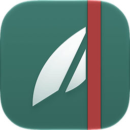
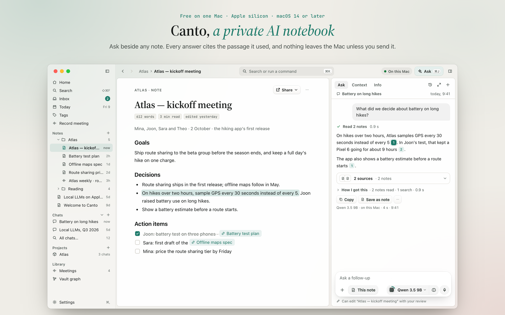
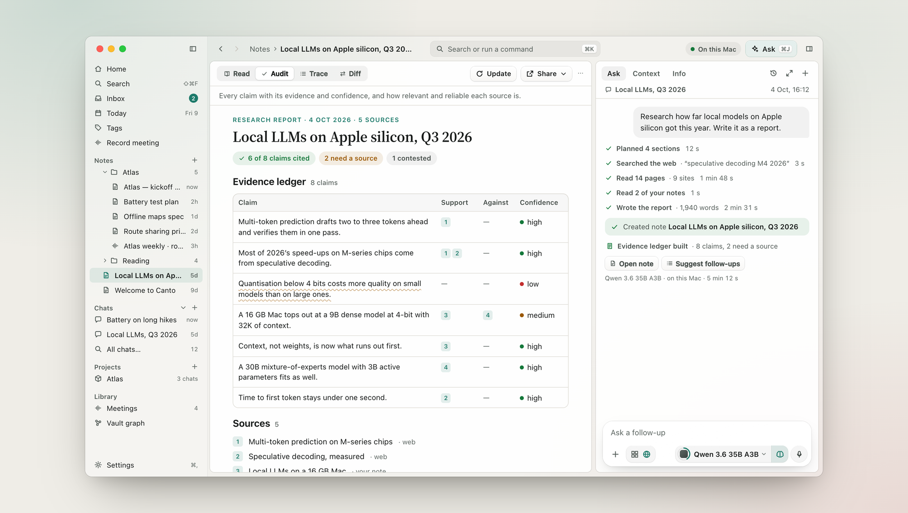
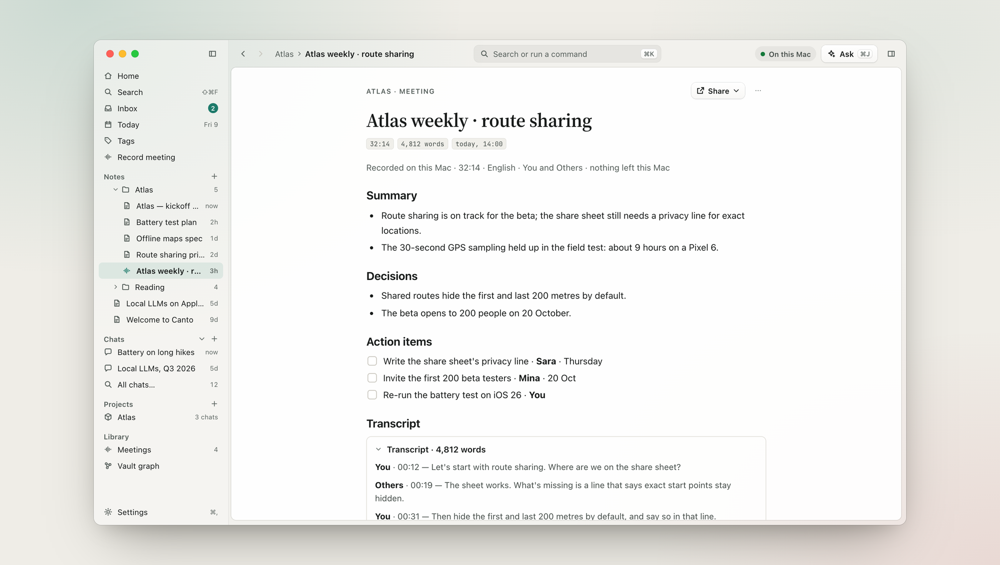
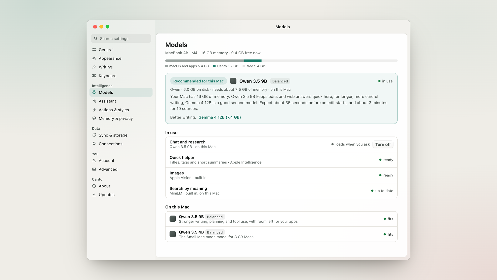
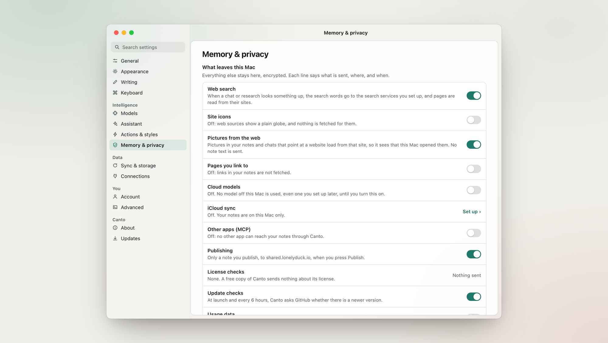

  <picture>
    <source media="(prefers-color-scheme: dark)" srcset="assets/icon-dark.png">
    
  </picture>

<h1 align="center">Canto</h1>

  <b>A private AI notebook for your Mac.</b> 
  Notes, cited answers, research and meetings, with the AI running on your Mac.

  <a href="https://lonelyduck.io/canto"><b>Download</b></a>
  &nbsp;·&nbsp;
  <a href="https://lonelyduck.io/canto#pricing">Pricing</a>
  &nbsp;·&nbsp;
  <a href="https://github.com/deokwons9004dev/Canto-Releases/releases">All releases</a>
  &nbsp;·&nbsp;
  <a href="https://www.reddit.com/r/CantoApp/">r/CantoApp</a>

  
  
  
  

Canto is a notebook where the AI runs on your Mac. Ask a question beside any note and the answer cites the passage it used; click a citation and the passage opens. Research reports list every claim with its sources. Meetings turn into notes with a summary, decisions and action items. Your notes live in an encrypted vault on your Mac, and nothing leaves it unless you turn on a feature that sends something, each one listed in Settings with its own switch.

This repository is where Canto's signed builds are published, and where the app looks for updates.

## Download

The easiest way is **[lonelyduck.io/canto](https://lonelyduck.io/canto)**, which always offers the newest build. You can also pick one from [Releases](https://github.com/deokwons9004dev/Canto-Releases/releases):

| | Where to find it | Who it's for |
| --- | --- | --- |
| **Canto 1.0 beta** | The newest **Pre-release** at the top of Releases | Most people. It's the default download on the website, and it keeps itself up to date with newer betas. |
| **Canto 0.10.3** | The release marked **Latest** | Anyone who would rather wait until 1.0 is out of beta. |

**To install:** download the `.dmg`, open it, and drag Canto into Applications. Every build is signed with my Apple Developer ID and notarized by Apple, so macOS opens it after its usual "downloaded from the internet" question.

**Coming from 0.x?** The first time 1.0 opens, it backs up your notes database and then updates it. Your license moves over by itself and now covers 3 Macs, with 12 months of new features from 1.0. The beta 1 release notes end with "Going back to 0.10.3", in case you need to.

## A look inside

### Research notes that show their work

Ask for a report and Canto plans it, searches the web if you let it, reads the pages and your own notes, and writes a note in your language, Korean included. Its evidence ledger lists every claim with its sources, the sources against it, and how sure Canto is. *Deep research is part of Pro.*

### Meetings, transcribed on this Mac

Your microphone is You and your Mac's sound is Others. Both are transcribed on the Mac, and when the meeting ends you get a note with a summary, decisions and action items, with the full transcript below. Nothing about the meeting leaves the Mac. *Meetings are part of Pro, and transcripts need macOS 26.*

### Models picked for your chip and memory

Canto recommends a model for your Mac by its chip as well as its memory, tells you how long things will take, and plans the memory before it loads anything. Choosing a model never loads it; it loads when you ask. Macs with 8 GB run in Small Mac mode. You can also use Ollama, LM Studio, oMLX or llama.cpp's server, or OpenRouter on your own account.

### What leaves this Mac is one list

Settings › Memory & privacy › **What leaves this Mac** lists every feature that can send anything: web search, cloud models, iCloud sync, publishing, update checks, license checks, usage data, model downloads and the rest. Each line says what is sent, where and when, and has a real switch. A free copy sends nothing about a license, and search by meaning works offline.

### Also in Canto

- **⌘K** searches your notes and chats, by word and by meaning, and runs any command.
- **Quick capture** (⌥Space) saves a thought from anywhere.
- **Dictation**, and text read from images and scanned PDFs, all done on the Mac.
- **Edits with review:** Ask can change a note, and you see the difference before you keep it.
- **Canvases**, a **vault graph** of how your notes link, **version history**, local **backups** and a **vault lock**.
- **Imports** from Apple Notes, Evernote, and Markdown folders such as an Obsidian vault. Folders on your Mac can also be linked and searched where they are.
- **Publish** a note as a web page, and let other apps use your notes over **MCP**, with a token you control.

## Free and Pro

The whole app is free on one Mac, with no account. Pro is a one-time purchase that adds the bigger jobs.

| | Free | Pro&nbsp;·&nbsp;1&nbsp;Mac | Pro&nbsp;·&nbsp;3&nbsp;Macs |
| --- | :---: | :---: | :---: |
| **Price** | Free | $29 once | $39 once |
| Unlimited AI on your Mac: Ask with citations, quick research, rewrite and summarise | ✓ | ✓ | ✓ |
| Any local model, your own model servers, OpenRouter on your account | ✓ | ✓ | ✓ |
| Dictation, canvases, the graph, version history, backups and export | ✓ | ✓ | ✓ |
| Published pages | 3 | 50 | 50 |
| Deep research reports with the evidence ledger | | ✓ | ✓ |
| Meetings | | ✓ | ✓ |
| Edits across many notes, and write access for apps over MCP | | ✓ | ✓ |
| All palettes | | ✓ | ✓ |
| Encrypted iCloud sync between your Macs | | | ✓ |

- **Try first:** every Pro feature can be used three times on Free.
- **No subscription:** Pro includes the Pro features released in the 12 months after you buy, and you keep them for good. Another 12 months is optional ($19, or $15 if you renew before your date). Every update, bug fix and security fix stays free for everyone.
- **Students and teachers:** write to support@lonelyduck.io from your school address for a discount.

Prices are in US dollars; card payments in Korea can be in won. See [lonelyduck.io/canto](https://lonelyduck.io/canto#pricing) for current prices.

## Requirements

- A Mac with Apple silicon (M1 or later). Intel Macs aren't supported.
- macOS 14 or later. Meeting transcripts need macOS 26. Apple Intelligence features (titles, tags and short summaries) need a Mac where Apple Intelligence is available and turned on.
- 8 GB of memory or more. 8 GB Macs use Small Mac mode with a smaller model; 16 GB and up can run larger ones.
- Local models are a separate download of a few gigabytes each. Canto shows the size and the memory a model needs before you download it.

## Updates

Canto checks this repository for a newer version when it starts and every 6 hours. If you installed a beta, it follows betas. You can check right away in Settings › Updates, or turn checks off in Settings › Memory & privacy › What leaves this Mac › Update checks.

What changed in each version is in its release notes on the [Releases](https://github.com/deokwons9004dev/Canto-Releases/releases) page, and in Canto under What's New.

<b>What the files in a release are for</b>

 

| File | What it is |
| --- | --- |
| `Canto-<version>-arm64.dmg` | The installer. This is the one to download. |
| `Canto-<version>-arm64-mac.zip` | The same app, which Canto's updater downloads. |
| `*.blockmap` | Lets the updater download only the parts that changed. |
| `latest-mac.yml`, `beta-mac.yml` | The update feed: the newest version and the SHA-512 of its files, which the updater checks before it installs. |

## Privacy and security

- Your vault is a single encrypted database on your Mac, with its key in your Keychain.
- iCloud sync (Pro · 3 Macs) is encrypted on your Mac with a key only your Macs have. Apple can't read it, and neither can I.
- To check that a download is genuine, or to report a security problem privately, see [SECURITY.md](SECURITY.md).
- [Privacy policy](https://lonelyduck.io/legal/privacy) · [Terms of service](https://lonelyduck.io/legal/terms)

## Help and feedback

- **Questions and ideas:** [r/CantoApp](https://www.reddit.com/r/CantoApp/)
- **Bugs:** [open an issue](https://github.com/deokwons9004dev/Canto-Releases/issues) here, with your Canto and macOS versions
- **Anything else:** support@lonelyduck.io

## License

Canto is proprietary software, free to use under the [Canto End User License Agreement](EULA.txt) ([LICENSE](LICENSE)). It includes open-source software, a language model and fonts under their own licenses, listed in Canto under Settings › About › Third-party notices.

---

  Made by David Song, a solo developer in Korea, at <a href="https://lonelyduck.io">LonelyDuck</a>. 
  <a href="https://www.linkedin.com/in/lonelyduck/">LinkedIn</a> · <a href="https://github.com/deokwons9004dev">GitHub</a>

